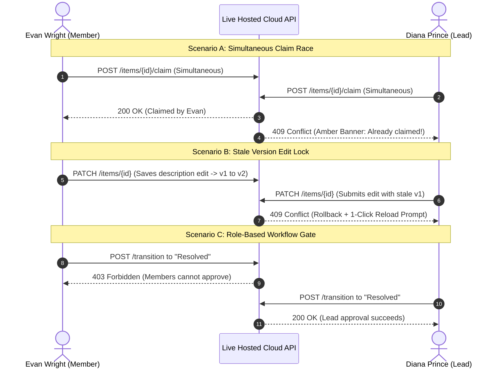
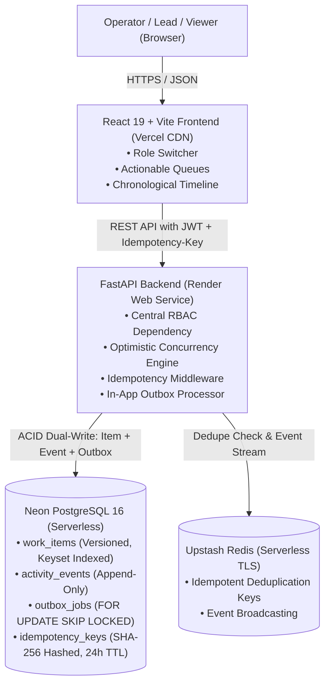

# NeoHelp — Operations Under Pressure
> **Live Operational Task Coordination, Concurrency-Safe Incident Resolution, and Immutable Audit Chronology Platform**

[](https://neo-help.vercel.app/)
[](https://neohelp-backend.onrender.com)
[](https://neon.tech)
[](https://upstash.com)
[](https://github.com/Utkarsh00123/NeoHelp)

---

## 📌 Project Overview & Author Context

Hi, I am **Utkarsh Chauhan**, a student at **Galgotias College of Engineering and Technology (GCET)**. 

I engineered **NeoHelp** for the **Newtonite Operations Challenge** (`newtonite-ops-2300971530133`). 

During live high-pressure incident mitigation and compliance reviews, teams often rely on ad-hoc Slack threads and spreadsheets. These brittle workflows suffer from lost updates, duplicate task claims, and nonexistent audit trails. NeoHelp was designed with a strict engineering ethos: **prioritize concurrency correctness, data integrity, and server-side authorization over superficial UI bloat.**

### 🌐 Live Production Links
* **Live Web Dashboard (Vercel):** [https://neo-help.vercel.app/](https://neo-help.vercel.app/)
* **Live API & Health Probe (Render):** [https://neohelp-backend.onrender.com/api/health](https://neohelp-backend.onrender.com/api/health)
* **Interactive API Documentation (Swagger):** [https://neohelp-backend.onrender.com/docs](https://neohelp-backend.onrender.com/docs)

---

## 🖥️ User Interface & Experience Design

NeoHelp adheres strictly to a **Timeline-First, Anti-Slop Minimalist Design System** ([Step 7 Directive](file:///Users/utkarshchauhan/Desktop/Neohelp/step7)). The interface completely eliminates generic AI decorations, unnecessary gradients, and filler text in favor of an actionable operational cockpit:
* **Strict 3-Color Palette:** Pure white canvas (`#ffffff`), high-contrast crisp black typography (`#000000`), and subtle light blue accents (`#0284c7`) reserved strictly for interactive affordances and critical alerts.
* **Actionable Master-Detail Split:** Left pane houses server-side filtered queues (*Assigned to Me*, *Unassigned Urgent*, *Awaiting Approval*) backed by keyset cursor pagination; right pane renders the **Master Chronological Timeline** weaving state changes, priority shifts, owner transfers, and discussion notes into one continuous feed.

```
+---------------------------------------------------------------------------------------------------------+
| NeoHelp / Timeline Operations        API: Connected • DB: Active • Redis: Active     [ Active User: Diana ]|
+---------------------------------------------------------------------------------------------------------+
| [ All Items ]  [ Assigned to me ]  [ Unassigned urgent ]  [ Awaiting approval ]  [Clear Board] [+ New Task] |
+------------------------------------------+--------------------------------------------------------------+
|  FILTERED QUEUE (Cursor-Paginated)       |  MASTER TIMELINE & INCIDENT DETAILS                          |
|                                          |                                                              |
|  [Card] Production DB Latency Spike      |  Production Database Latency Spike                           |
|         Status: Open • Priority: Urgent  |  Status: Open • Priority: Urgent • Version: v1               |
|         Team: Incident Response • v1     |                                                              |
|         Unassigned                       |  [ Claim Task ]  [ Advance to In Progress ]  [ Edit ]        |
|                                          |  ----------------------------------------------------------  |
|  [Card] Ingress TLS Rotation Drill       |  CHRONOLOGICAL EVENT LOG                                     |
|         Status: In Progress • Medium     |  ● 14:02  Item created by Diana Prince (Lead)                |
|         Assignee: Bob Smith • v2         |  ● 14:05  Claimed by Evan Wright (Member)                    |
|                                          |  ● 14:12  State transitioned: Open → In Progress             |
|  [Card] SOC2 Evidence Collection Gate    |  ● 14:15  Comment by Evan Wright: "Investigating pod logs."   |
|         Status: Awaiting Approval • High |                                                              |
+------------------------------------------+--------------------------------------------------------------+
```

---

## 🧪 Live Concurrency & Multi-Device Testing Protocol

Anyone reviewing or grading this project can verify all critical concurrency mechanisms, authorization gates, and rollback alerts live across multiple devices (e.g., your laptop, your phone, or two different browser windows):

### 1. Preparation: Start with a Fresh or Blank Slate
You can test with the pre-seeded dataset of 2,500 items, or start with a **clean board**:
* Click **`Clear All Tasks (Blank Slate)`** in the top navigation bar to reset the board to 0 items.
* Alternatively, click **`+ New Task`** to create a test incident on the fly.

### 2. Open Two Different Sessions
* **Device 1 (Laptop / Tab A):** Set user dropdown to **Diana Prince** (`lead.incident@neohelp.io` — **Lead**, Incident Response).
* **Device 2 (Mobile / Tab B):** Set user dropdown to **Evan Wright** (`member.incident@neohelp.io` — **Member**, Incident Response).

---

### Step-by-Step Test Scenarios



#### Test A: The Simultaneous Claim Race (`409 Conflict`)
1. Create or select an unassigned task in the *Incident Response* team.
2. Position both devices so you can see both screens.
3. Tap **`Claim Task`** on both devices at the exact same millisecond.
4. **Expected Result:**
   * Exactly **one** device succeeds (`200 OK`) and assigns the task.
   * The other device is rejected with **`409 Conflict`** and displays a prominent notification: *Conflict: This item has already been claimed by another operator.*

#### Test B: Optimistic Locking & Stale Overwrite Protection (`409 Conflict`)
1. Open the same task on both devices.
2. On **Device 1**, click **`Edit Details`**, change the description, and save (item version increments from $v1 \to v2$).
3. On **Device 2**, without refreshing (Device 2 still has stale version $v1$ in memory), click **`Edit Details`** and attempt to save a change.
4. **Expected Result:**
   * Device 2 is rejected with **`409 Conflict`**.
   * The UI performs an automatic rollback and prompts: *"This work item was modified by another operator. Reload changed item"*, preventing silent data loss.

#### Test C: Workflow State Machine & Approval Gates (`403 Forbidden` vs `200 OK`)
1. On **Evan Wright's device (Member)**:
   * Click **`Advance to In Progress`** $\to$ Confirm. (Succeeds)
   * Click **`Advance to Awaiting Approval`** $\to$ Confirm. (Succeeds)
   * Now attempt to click **`Advance to Resolved`**.
   * **Expected Result:** Rejected with **`403 Forbidden`**: *Advancing an item to 'Resolved' requires a Lead or Admin role for this team.*
2. On **Diana Prince's device (Lead)**:
   * Click **`Advance to Resolved`** $\to$ enter a sign-off note $\to$ Confirm.
   * **Expected Result:** Succeeds immediately (`200 OK`). The item turns green, and the sign-off event appears on the live timeline.

#### Test D: Viewer Role Read-Only Enforcement (`403 Forbidden`)
1. Switch to **Julia Roberts** (`viewer.global@neohelp.io` — **Viewer**).
2. Attempt to claim, edit, transition, or comment on any item.
3. **Expected Result:** Blocked server-side with **`403 Forbidden: Viewer role cannot mutate items`**.

---

## 👥 Seeded Demo Accounts (Password: `password123`)

The application comes pre-loaded with multi-role accounts across 4 operational teams:

| Full Name | Email Address | Primary Team & Role | Secondary Memberships |
|---|---|---|---|
| **Alice Walker** | `admin@neohelp.io` | **Core Infrastructure** (Admin) | Incident Response (Admin) |
| **Diana Prince** | `lead.incident@neohelp.io` | **Incident Response** (Lead) | Core Infrastructure (Member) |
| **Evan Wright** | `member.incident@neohelp.io` | **Incident Response** (Member) | — |
| **Bob Martinez** | `lead.core@neohelp.io` | **Core Infrastructure** (Lead) | Payments & Billing (Viewer) |
| **Charlie Kim** | `member.core@neohelp.io` | **Core Infrastructure** (Member) | — |
| **George Clark** | `lead.payments@neohelp.io` | **Payments & Billing** (Lead) | — |
| **Hannah Abbott** | `member.payments@neohelp.io` | **Payments & Billing** (Member) | — |
| **Ian Malcolm** | `lead.compliance@neohelp.io` | **Compliance & Trust** (Lead) | Core Infrastructure (Viewer) |
| **Julia Roberts** | `viewer.global@neohelp.io` | **Global Viewer** (Viewer) | Viewer across all 4 teams |

*(Use the top-bar dropdown to switch between these users with one click without re-entering credentials).*

---

## 🏗️ System Architecture & Concurrency Model



### Core Technical Guarantees

1. **Atomic Dual-Write Guarantee:**
   Every single mutating HTTP action writes to [`work_items`](file:///Users/utkarshchauhan/Desktop/Neohelp/backend/app/models/work_item.py), appends an audit record to [`activity_events`](file:///Users/utkarshchauhan/Desktop/Neohelp/backend/app/models/activity_event.py), and enqueues an asynchronous side effect to [`outbox_jobs`](file:///Users/utkarshchauhan/Desktop/Neohelp/backend/app/models/outbox.py) inside the **exact same database transaction**. State changes and audit trails can never drift out of sync.
2. **Conditional Atomic Claims:**
   Executed via SQL: `UPDATE work_items SET assignee_id=:uid, version=version+1 WHERE id=:id AND assignee_id IS NULL`. If rowcount is 0, someone claimed it concurrently; the transaction rolls back and returns a `409 Conflict`.
3. **Optimistic Version Locking:**
   All updates execute strictly `WHERE id=:id AND version=:client_version`. Stale edits are rejected with `409 Conflict` and return the latest server representation for non-destructive reconciliation.
4. **Idempotency Deduplication:**
   Mutating `POST` requests accept an `Idempotency-Key` header. Payloads are SHA-256 hashed and cached in `idempotency_keys` with a 24-hour expiration. Repeated submissions return the cached response without re-executing logic.
5. **Transactional Outbox Worker:**
   Asynchronous jobs are processed using `SELECT ... FOR UPDATE SKIP LOCKED` with Redis deduplication, exponential backoff, and a strict dead-letter cap (`max_attempts = 3`).
6. **High-Performance Keyset Cursor Pagination:**
   Lists avoid standard SQL `OFFSET` degradation. Feeds are indexed on `(team_id, status, priority, id)` and paged using compound timestamp-ID cursors (`${created_at.timestamp()}__${id}`), ensuring consistent sub-millisecond lookups regardless of depth.

---

## 💻 Local One-Command Setup

If you prefer testing locally with Docker Compose:

```bash
# 1. Clone repository
git clone https://github.com/Utkarsh00123/NeoHelp.git
cd NeoHelp

# 2. Spin up complete stack (Postgres, Redis, Backend, Worker, Frontend)
docker compose up --build
```

Endpoints will be available at:
* **Frontend:** `http://localhost:5173`
* **Backend API:** `http://localhost:8000`
* **Swagger Documentation:** `http://localhost:8000/docs`
* **Health Check:** `http://localhost:8000/api/health`

---

## ⚡ Automated Pytest Suite

Run the risk-based concurrency and authorization test suite:

```bash
# Inside docker container or local environment
pytest
```

```text
============================= test session starts ==============================
collected 21 items

tests/test_auth.py .....                                                 [ 23%]
tests/test_critical_risk_behaviors.py ....                               [ 42%]
tests/test_health.py ..                                                  [ 52%]
tests/test_items_concurrency.py ......                                   [ 80%]
tests/test_seed.py ..                                                    [ 90%]
tests/test_worker_outbox.py ..                                           [100%]

============================== 21 passed in 5.26s ==============================
```

All 21 automated tests validate edge cases including parallel claim races, stale version rejections, repeated idempotency submissions, invalid state jumps, and cross-team authorization boundaries.

---

## 📄 License & Attribution
Designed and built by **Utkarsh Chauhan** (GCET) for the **Newtonite** Engineering Challenge. Released under the MIT License.
