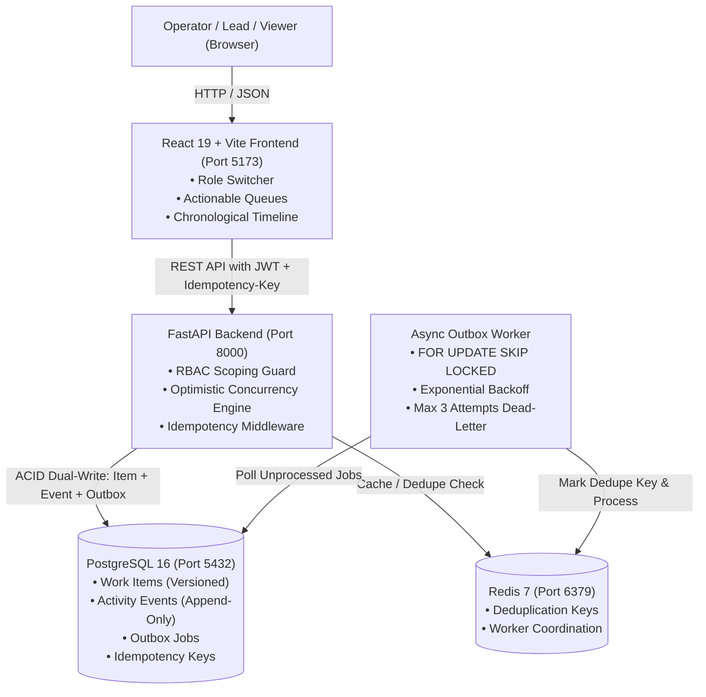

# NeoHelp — Operations Under Pressure (`newtonite-ops-2300971530133`)

NeoHelp is an internal timeline-first operational coordination platform built for high-stress incident triage, cross-team task management, and compliance auditing. Engineered with optimistic locking, strict server-side role-based access control (RBAC), idempotency deduplication, and a transactional outbox worker, the system eliminates race conditions and provides an immutable audit chronology across teams.



---

## 🚀 One-Command Quick Start

Spin up PostgreSQL, Redis, FastAPI Backend, Async Outbox Worker, and React Frontend with a single command:

```bash
docker compose up --build
```

### Active Endpoints
* **Frontend Web Dashboard**: [http://localhost:5173](http://localhost:5173)
* **Backend API & Swagger UI**: [http://localhost:8000/docs](http://localhost:8000/docs)
* **Live System Health Probe**: [http://localhost:8000/api/health](http://localhost:8000/api/health)

---

## 🧪 Exact One-Command Test Suite

Execute the full suite of 21 automated tests (including risk-based concurrency tests for parallel claims, stale version conflicts, idempotency deduplication, and workflow authorization gates):

```bash
docker compose exec backend pytest
```

---

## 👥 Seeded Demo Users (All Passwords: `password123`)

The database is pre-seeded with 4 teams (*Core Infrastructure*, *Incident Response*, *Payments & Settlements*, *Compliance & Trust*), 10 multi-role users, 2,500+ work items, and 6,500+ audit events. Switch users instantly via the header dropdown:

| User Name | Email | Primary Team & Role | Secondary Memberships |
|---|---|---|---|
| **Alice Walker** | `admin@neohelp.io` | **Core Infrastructure** (Admin) | Incident Response (Admin) |
| **Bob Martinez** | `lead.core@neohelp.io` | **Core Infrastructure** (Lead) | Payments & Settlements (Viewer) |
| **Charlie Kim** | `member.core@neohelp.io` | **Core Infrastructure** (Member) | — |
| **Diana Prince** | `lead.incident@neohelp.io` | **Incident Response** (Lead) | Core Infrastructure (Member) |
| **Evan Wright** | `member.incident@neohelp.io` | **Incident Response** (Member) | — |
| **Fiona Gallagher** | `viewer.incident@neohelp.io` | **Incident Response** (Viewer) | Compliance & Trust (Viewer) |
| **George Clark** | `lead.payments@neohelp.io` | **Payments & Settlements** (Lead) | — |
| **Hannah Abbott** | `member.payments@neohelp.io` | **Payments & Settlements** (Member) | — |
| **Ian Malcolm** | `lead.compliance@neohelp.io` | **Compliance & Trust** (Lead) | Core Infrastructure (Viewer) |
| **Jack Reacher** | `member.compliance@neohelp.io` | **Compliance & Trust** (Member) | — |

---

## ⚡ Critical System Behaviors Implemented

1. **Concurrent Claim Race Protection (`POST /api/items/{id}/claim`)**:
   Atomic conditional update (`WHERE assignee_id IS NULL`). If two operators claim simultaneously, exactly one succeeds (`200 OK`) and the second receives `409 Conflict`.
2. **Stale Edit Locking (`PATCH /api/items/{id}`)**:
   Optimistic version locking (`WHERE version = :client_version`). Stale updates are rejected with `409 Conflict` returning the current server state for immediate user reconciliation without data loss.
3. **Idempotency Deduplication (`Idempotency-Key` header)**:
   Payloads are SHA256 hashed and cached with a 24-hour TTL in `idempotency_keys`. Replayed requests return the exact stored response without re-executing business logic.
4. **Workflow & Approval Gate (`POST /api/items/{id}/transition`)**:
   Enforces valid state machine jumps (`Open ↔ In Progress → Awaiting Approval → Resolved → Closed`). Advancing to `Resolved` or `Closed` requires a `Lead` or `Admin` role (`403 Forbidden` for Members and Viewers).
5. **Server-Side RBAC Guard**:
   Centralized dependency checks team membership and role permissions on every read/write operation. Non-members receive `403 Forbidden`; Viewers are restricted to read-only access.
6. **Transactional Outbox Worker**:
   Events are committed to `outbox_jobs` in the exact same DB transaction as state updates. A background worker polls with `SELECT ... FOR UPDATE SKIP LOCKED`, deduplicates via Redis, applies exponential backoff, and caps failures at `max_attempts = 3`.

---

## 📈 Known Limitations & 10x Scale Roadmap

When scaling beyond 10,000 concurrent operators and 10,000,000 work items:

1. **PostgreSQL Read Replicas**:
   Route high-volume dashboard feed queries (`GET /api/items`) to read replicas with connection pooling (e.g., PgBouncer), reserving primary master nodes exclusively for optimistic lock mutations and outbox polling.
2. **Horizontal Partitioning for `activity_events`**:
   Partition `activity_events` by date range (monthly declarative partitioning) or `work_item_id` hash to maintain sub-millisecond append latency as audit logs scale into tens of millions of records.
3. **Dedicated Full-Text Search Engine**:
   Transition from PostgreSQL `ILIKE` / GiST indexing to an external distributed search engine (OpenSearch or Meilisearch) synchronized via the transactional outbox pipeline for multi-field fuzzy search.
4. **WebSockets / Server-Sent Events (SSE)**:
   Upgrade frontend timeline updates from 15-second TanStack Query polling to Redis Pub/Sub powered Server-Sent Events for real-time multi-operator cursor and timeline synchronization.
