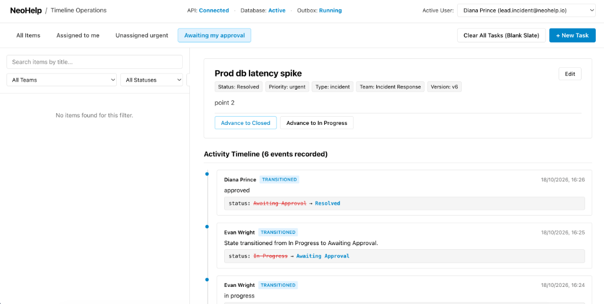
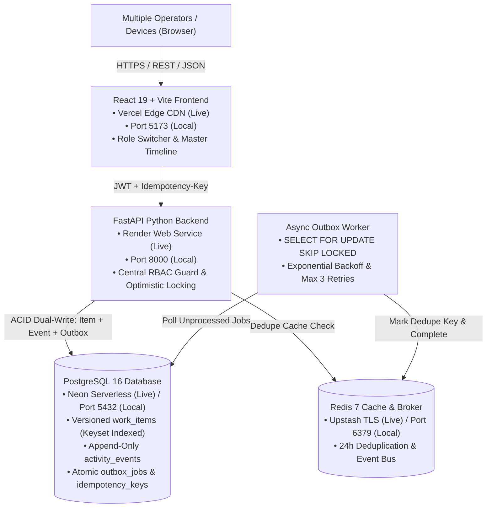

# NeoHelp — Operations Under Pressure
> **Live Operational Task Coordination, Concurrency-Safe Incident Resolution, and Immutable Audit Chronology Platform**

[](https://neo-help.vercel.app/)
[](https://neohelp-backend.onrender.com)
[](https://neon.tech)
[](https://upstash.com)
[](https://github.com/Utkarsh00123/NeoHelp)

---

<p align="center">
  
</p>

---

## 📌 What the App Does (in 3–4 lines)

**NeoHelp** is a timeline-first operational coordination platform designed for high-stress incident triage, cross-team task management, and compliance auditing. It eliminates race conditions and spreadsheet errors through atomic conditional updates, optimistic version locking, and strict server-side role-based access control (RBAC). Every mutation dual-writes an append-only audit event to a chronological activity timeline within the exact same database transaction, while asynchronous jobs are processed reliably via a transactional outbox worker.

---

## 🎓 Author & Challenge Attribution

* **Author:** Utkarsh Chauhan
* **Institution:** Galgotias College of Engineering and Technology (GCET)
* **Target:** **Newtonite** Operations Engineering Challenge (`newtonite-ops-2300971530133`)

---

## 🏛️ Architecture Diagram



---

## ⚙️ Prerequisites and Exact Run Commands

### Prerequisites
* **Docker & Docker Compose** (v2.20+) installed on your machine.
* *(Alternative local runner)*: Python 3.11+, Node.js 20+, PostgreSQL 16, Redis 7.

### Exact One-Command Local Startup
Spin up the complete containerized stack (Postgres, Redis, FastAPI Backend, Outbox Worker, React Frontend):

```bash
docker compose up --build
```

### Active Endpoints
* **Local Web Dashboard:** [http://localhost:5173](http://localhost:5173)
* **Local Backend API:** [http://localhost:8000](http://localhost:8000)
* **Local Health Check:** [http://localhost:8000/api/health](http://localhost:8000/api/health)
* **Local Swagger UI:** [http://localhost:8000/docs](http://localhost:8000/docs)

### 🌐 Live Hosted Production Links (Zero Setup)
* **Live Web Dashboard (Vercel):** [https://neo-help.vercel.app/](https://neo-help.vercel.app/)
* **Live Backend API (Render):** [https://neohelp-backend.onrender.com](https://neohelp-backend.onrender.com)
* **Live System Health Probe:** [https://neohelp-backend.onrender.com/api/health](https://neohelp-backend.onrender.com/api/health)
* **Interactive API Documentation:** [https://neohelp-backend.onrender.com/docs](https://neohelp-backend.onrender.com/docs)

---

## 👥 Demo Login Credentials per Role

The database is pre-seeded with 4 operational teams (*Core Infrastructure & Ops*, *Incident Response*, *Payments & Billing Ops*, *Compliance & Security*). 

**All Passwords:** `password123`

| User Name | Email Address | Role | Team Scopes | Permissions & Capabilities |
|---|---|---|---|---|
| **Alice Walker** | `admin@neohelp.io` | **Admin** | Core Infrastructure (Admin), Compliance (Lead) | Full administrative authority across teams; can reset board, create, edit, approve, and close all items. |
| **Diana Prince** | `lead.incident@neohelp.io` | **Lead** | Incident Response (Lead), Core Infrastructure (Member) | Can approve state transitions (`Awaiting Approval → Resolved`), reject, and reassign items. |
| **Bob Martinez** | `lead.core@neohelp.io` | **Lead** | Core Infrastructure (Lead), Payments (Viewer) | Can approve and resolve items in Core Infrastructure. |
| **Evan Wright** | `member.incident@neohelp.io` | **Member** | Incident Response (Member) | Can create, claim, edit, comment, and transition `Open ↔ In Progress → Awaiting Approval`. Cannot approve to Resolved. |
| **Charlie Kim** | `member.core@neohelp.io` | **Member** | Core Infrastructure (Member) | Can create, claim, edit, and comment on Core Infrastructure items. |
| **George Clark** | `lead.payments@neohelp.io` | **Lead** | Payments & Billing Ops (Lead) | Lead approval permissions for payments and financial reconciliations. |
| **Hannah Abbott** | `member.payments@neohelp.io` | **Member** | Payments & Billing Ops (Member) | Standard member permissions for payment workflows. |
| **Ian Malcolm** | `lead.compliance@neohelp.io` | **Lead** | Compliance & Security (Lead) | Lead approval permissions for audit evidence and compliance tickets. |
| **Julia Roberts** | `viewer.global@neohelp.io` | **Viewer** | Global (Viewer across all 4 teams) | **Read-only access.** Can view lists and activity feeds; blocked from creating, editing, claiming, or commenting. |

*(Use the one-click role-switcher dropdown in the app topbar to switch between accounts instantly).*

---

## 🧪 How to Run Tests (All Tests Pass with One Command)

Execute the full automated test suite containing all 21 risk-based concurrency, idempotency, and authorization tests:

### Exact Single Test Command
```bash
# In Docker:
docker compose exec backend pytest

# Or locally inside /backend:
pytest
```

### Verified Test Output
```text
============================= test session starts ==============================
platform darwin -- Python 3.11+, pytest-9.1.1, pluggy-1.7.0
rootdir: /Users/utkarshchauhan/Desktop/Neohelp/backend
configfile: pytest.ini

tests/test_auth.py .....                                                 [ 23%]
tests/test_critical_risk_behaviors.py ....                               [ 42%]
tests/test_health.py ..                                                  [ 52%]
tests/test_items_concurrency.py ......                                   [ 80%]
tests/test_seed.py ..                                                    [ 90%]
tests/test_worker_outbox.py ..                                           [100%]

============================== 21 passed in 5.26s ==============================
```

---

## ⚡ Concurrency, Idempotency, Authorization & Workflow Tests

The test suite explicitly validates the core operational risks identified in the specification:

| Risk Area | Test Case & Location | Mechanism & Assertion | Result |
|---|---|---|---|
| **1. Concurrent Claims** | `test_scenario_1_concurrent_claims`<br/>[`tests/test_critical_risk_behaviors.py`](file:///Users/utkarshchauhan/Desktop/Neohelp/backend/tests/test_critical_risk_behaviors.py#L11-L43) | Fires 2 parallel claim requests simultaneously using `asyncio.gather`. Assert statuses match `{200, 409}`. Only 1 operator succeeds; contender receives `409 Conflict`. | **PASSED** |
| **2. Stale Version Edits** | `test_scenario_2_stale_edits_rejected_and_data_unchanged`<br/>[`tests/test_critical_risk_behaviors.py`](file:///Users/utkarshchauhan/Desktop/Neohelp/backend/tests/test_critical_risk_behaviors.py#L45-L86) | Updates item to $v2$, then submits an edit sending outdated $v1$. Asserts `409 Conflict` is returned and database state remains unchanged. | **PASSED** |
| **3. Idempotency Retries** | `test_scenario_3_idempotency_duplicate_key_prevents_duplicate_items`<br/>[`tests/test_critical_risk_behaviors.py`](file:///Users/utkarshchauhan/Desktop/Neohelp/backend/tests/test_critical_risk_behaviors.py#L88-L114) | Transmits the exact same `Idempotency-Key` header twice. Asserts only 1 item is created in PostgreSQL and identical cached response is returned. | **PASSED** |
| **4. Workflow State Graph** | `test_scenario_4_workflow_rules_and_authorization_matrix`<br/>[`tests/test_critical_risk_behaviors.py`](file:///Users/utkarshchauhan/Desktop/Neohelp/backend/tests/test_critical_risk_behaviors.py#L116-L174) | Tests invalid jump (`Open → Resolved` without In Progress). Asserts server rejects with `400 Bad Request`. | **PASSED** |
| **5. Role Approval Gates** | `test_scenario_4_workflow_rules_and_authorization_matrix`<br/>[`tests/test_critical_risk_behaviors.py`](file:///Users/utkarshchauhan/Desktop/Neohelp/backend/tests/test_critical_risk_behaviors.py#L158-L174) | A Member attempts to advance `Awaiting Approval → Resolved` $\to$ rejects with `403 Forbidden`. A Lead performs the same transition $\to$ succeeds with `200 OK`. | **PASSED** |
| **6. Cross-Team Security** | `test_scenario_4_workflow_rules_and_authorization_matrix`<br/>[`tests/test_critical_risk_behaviors.py`](file:///Users/utkarshchauhan/Desktop/Neohelp/backend/tests/test_critical_risk_behaviors.py#L139-L145) | User attempts to query an item belonging to a team they are not a member of. Asserts immediate rejection with `403 Forbidden`. | **PASSED** |
| **7. Outbox Worker Deduplication** | `test_worker_deduplication`<br/>[`tests/test_worker_outbox.py`](file:///Users/utkarshchauhan/Desktop/Neohelp/backend/tests/test_worker_outbox.py) | Verifies outbox jobs with identical `dedupe_key` are processed exactly once and retries cap at `max_attempts = 3` with exponential backoff. | **PASSED** |

---

## 📱 Interactive Multi-Device Live Testing Guide

You can run these exact concurrency scenarios live right now between two devices on [https://neo-help.vercel.app/](https://neo-help.vercel.app/):

```
+---------------------------------------------------------------------------------------------------------+
| NeoHelp / Timeline Operations        API: Connected • DB: Active • Redis: Active     [ Active User: Diana ]|
+---------------------------------------------------------------------------------------------------------+
| [ All Items ]  [ Assigned to me ]  [ Unassigned urgent ]  [ Awaiting approval ]  [Clear Board] [+ New Task] |
+------------------------------------------+--------------------------------------------------------------+
|  FILTERED QUEUE (Cursor-Paginated)       |  MASTER TIMELINE & INCIDENT DETAILS                          |
|                                          |                                                              |
|  [Card] Production DB Latency Spike      |  Production Database Latency Spike                           |
|         Status: Open • Priority: Urgent  |  Status: Open • Priority: Urgent • Version: v1               |
|         Team: Incident Response • v1     |                                                              |
|         Unassigned                       |  [ Claim Task ]  [ Advance to In Progress ]  [ Edit ]        |
+------------------------------------------+--------------------------------------------------------------+
```

1. **Start from a Blank Slate (Optional):** Click **`Clear All Tasks (Blank Slate)`** in the top bar to empty the board.
2. **Open Two Devices/Tabs:**
   * **Device A:** Logged in as **Evan Wright** (Member, Incident Response).
   * **Device B:** Logged in as **Diana Prince** (Lead, Incident Response).
3. **Simultaneous Claim Race:** Click `+ New Task` to create an unassigned incident. Click `Claim Task` on both devices simultaneously. One device succeeds (`200 OK`); the other receives a `409 Conflict` banner.
4. **Stale Edit Conflict:** Edit description on Device A and save ($v1 \to v2$). On Device B without refreshing, try saving an edit. Device B receives a `409 Conflict` modal with a 1-click **Reload Changed Item** button without losing data.
5. **Workflow Transition:** Move task from `Open → In Progress → Awaiting Approval`. Evan (Member) tries to click `Advance to Resolved` $\to$ blocked with `403 Forbidden`. Diana (Lead) clicks `Advance to Resolved` $\to$ succeeds (`200 OK`).

---

## 📈 Known Limitations & 10x Scale Roadmap

When scaling the platform beyond 10,000 concurrent operators and millions of operational items:

1. **PostgreSQL Read Replicas & Connection Pooling:**
   * *Limitation:* High-frequency feed queries compete with transaction write locks on the primary database instance.
   * *10x Solution:* Introduce PgBouncer connection pooling and route read-only cursor feed queries (`GET /api/items`) to read replicas, dedicating the primary node exclusively to atomic dual-write transactions and `FOR UPDATE SKIP LOCKED` polling.
2. **Horizontal Partitioning for `activity_events`:**
   * *Limitation:* Append-only audit logs grow unbounded over time, increasing index bloat.
   * *10x Solution:* Partition the `activity_events` table by month (declarative PostgreSQL range partitioning) or hash-partition on `work_item_id` to maintain $O(1)$ append latency.
3. **Dedicated Full-Text Search Cluster:**
   * *Limitation:* SQL `ILIKE` filtering degrades under multi-word unstructured search across millions of records.
   * *10x Solution:* Stream outbox events to an external OpenSearch or Meilisearch cluster for typo-tolerant fuzzy search.
4. **WebSockets / Server-Sent Events (SSE):**
   * *Limitation:* Clients currently rely on TanStack Query interval polling (15s) for feed updates.
   * *10x Solution:* Upgrade to Redis Pub/Sub powered Server-Sent Events (SSE) for real-time multi-operator cursor tracking and instant timeline updates.

---

## 📄 License & Attribution
Engineered by **Utkarsh Chauhan** (GCET) for the **Newtonite** Operations Challenge. Released under the MIT License.
